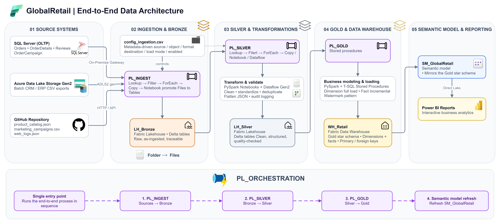

# GlobalRetail: End-to-End Data Platform on Microsoft Fabric


> A production-style **Medallion Architecture** (Bronze → Silver → Gold) built natively on **Microsoft Fabric**. It ingests data from three heterogeneous sources, cleans and models it and exposes a star schema to **Power BI** through a **Direct Lake** semantic model, all triggered by a single orchestration pipeline.



Here to see the detailed architecture schema: [Detailed Architecture](docs/Images/architecture/GlobalRetail_Architecture_Low_Level.drawio.svg)

---

## 🎯 Project Overview & Key Features

**GlobalRetail** is a simulated retail company whose data lives in three different systems: batch exports from CRM/ERP, an OLTP e-commerce database and externally distributed files. The goal of this project is to demonstrate how a modern data platform can unify them using only Microsoft Fabric components:

- **Ingest** raw data from heterogeneous sources, driven by metadata
- **Transform** it through progressive layers of quality and structure
- **Model** it as a business-ready star schema
- **Serve** it to Power BI with Direct Lake performance

| Feature | Description |
|---|---|
| **Medallion Architecture** | Bronze (raw) → Silver (clean) → Gold (business model) |
| **Metadata-driven ingestion** | A single `config_ingestion.csv` controls what is ingested, from where, in which format, and how |
| **Multiple integration patterns** | On-premises gateway (SQL Server), ADLS Gen2 Landing Zone with OneLake Shortcuts, HTTP connector (GitHub) |
| **Right tool for each job** | PySpark notebooks, Dataflow Gen2 and T-SQL stored procedures, each used where it fits best |
| **Data quality & audit** | Automated profiling (duplicates, ghost rows, NULL %) and a shared `silver_audit_log` Delta table |
| **Full + incremental loads** | Dimensions reloaded in full; facts loaded incrementally with a **watermark pattern** |
| **Star schema in a Data Warehouse** | Explicit PK/FK constraints, organized into domain-based schemas |
| **One-click execution** | `PL_ORCHESTRATION` runs ingestion, transformation, loading and semantic model refresh end-to-end |

---

## 🔌 Data Sources
Explore the different source systems, their ingestion methods, raw datasets and associated scripts used in the project.

| Data Source | Type | Data | Overview | Raw Data |
| :--- | :--- | :--- | :--- | :--- |
| **ADLS Gen2** | Batch file exports (CSV), used as **Landing Zone** | CRM (`customers`, `legacy_customers`), ERP (`products`, `suppliers`, `inventory`) | [ADLS2 Source Overview](docs/Data%20Sources/ADLS2/ADLS2_source.md) | [Raw Data Folder](docs/Data%20Sources/ADLS2/ADLS2_raw_data) |
| **SQL Server (OLTP)** | Relational database, via On-premises Data Gateway | `Orders`, `OrderDetails`, `OrderCampaign`, `Reviews` | [SQL Server Source Overview](docs/Data%20Sources/SQL%20SERVER/SQL_SERVER_source.md) | [Raw Data Folder](docs/Data%20Sources/SQL%20SERVER/SQL_SERVER_raw_data) · [Setup Scripts](docs/Data%20Sources/SQL%20SERVER/scripts) |
| **GitHub Repository** | Files via HTTP connector (simulates an external API) | `product_catalog.json`, `marketing_campaigns.csv`, `web_logs.json` | [GitHub Source Overview](docs/Data%20Sources/GITHUB/GITHUB_source.md) | [Source Data Repository](globalretail-source-data) |
---

## 🏗️ Architecture & Data Layers

Follow the data journey through the Fabric architecture, from raw ingestion to the final business-ready model.

| # | Document | Content |
|---|---|---|
| 01 | [Architecture Overview](docs/Architecture/01.%20architecture_overview.md) | Overall architecture, data flow, Fabric components and design principles |
| 02 | [Naming Conventions](docs/Architecture/02.%20naming_conventions.md) | Naming standards adopted across the Fabric workspace |
| 03 | [Bronze Layer](docs/Architecture/03.%20bronze_layer.md) | Raw data ingestion and the metadata-driven process |
| 04 | [Silver Layer](docs/Architecture/04.%20silver_layer.md) | Cleansing, transformation, standardization and quality checks |
| 05 | [Gold Layer](docs/Architecture/05.%20gold_layer.md) | Star schema, business model and analytical layer |
| 06 | [Orchestration & Lineage](docs/Architecture/06.%20orchestration%20&%20lineage.md) | End-to-end execution pipeline and data lineage |
---

## 🛠️ Fabric Workspace Artifacts

Explore the notebooks, dataflows, SQL scripts and pipelines created within Microsoft Fabric, categorized by Medallion layer:

### Bronze Layer
- [NB_Bronze_Files_To_Delta.ipynb](fabric_workspace/01.%20bronze_layer/NB_Bronze_Files_To_Delta.ipynb) : Converts landed raw files into Bronze Delta tables.
- [NB_Bronze_Shortcut.ipynb](fabric_workspace/01.%20bronze_layer/NB_Bronze_Shortcut.ipynb) : Programmatically creates OneLake Shortcuts via Fabric REST API.
- [NB_load_web_logs.ipynb](fabric_workspace/01.%20bronze_layer/NB_load_web_logs.ipynb) : Downloads large Git LFS `web_logs.json` file directly to Lakehouse `Files/`.
- [PL_INGEST.json](fabric_workspace/01.%20bronze_layer/PL_INGEST.json) : Metadata-driven ingestion pipeline configuration.

### Silver Layer
- [Dataflow_crm_from_bronze_to_silver.pq](fabric_workspace/02.%20silver_layer/Dataflow_crm_from_bronze_to_silver.pq) : Power Query M script for cleansing CRM datasets.
- [NB_Silver_Analyze_Load_erp_tables.ipynb](fabric_workspace/02.%20silver_layer/NB_Silver_Analyze_Load_erp_tables.ipynb) : Cleans, profiles data quality, and loads ERP tables into Delta format.
- [NB_Silver_Analyze_Load_sales_tables.ipynb](fabric_workspace/02.%20silver_layer/NB_Silver_Analyze_Load_sales_tables.ipynb) : Standardizes and loads SQL Server-sourced tables.
- [NB_Silver_Clean_&_load_product_catalog.ipynb](fabric_workspace/02.%20silver_layer/NB_Silver_Clean_%26_load_product_catalog.ipynb) : Flattens nested JSON structures (`attributes` & `images`).
- [Silver_Pipeline.json](fabric_workspace/02.%20silver_layer/Silver_Pipeline.json) : Ingestion orchestrator for Silver transformation tasks.

### Gold Layer
- [01 Create Schemas.sql](fabric_workspace/03.%20gold_layer/01%20Create%20Schemas.sql) : Generates domain-based Data Warehouse schemas.
- [02 Create Tables.sql](fabric_workspace/03.%20gold_layer/02%20Create%20Tables.sql) : DDL script to create dimension and fact tables in `WH_Retail`.
- [03 Add PK & FK constraints.sql](fabric_workspace/03.%20gold_layer/03%20Add%20PK%20%26%20FK%20constraints.sql) — Applies primary key and foreign key integrity constraints.
- [03.1 Verifica Primary Keys.sql](fabric_workspace/03.%20gold_layer/03.1%20Verifica%20Primary%20Keys.sql) : Integrity validation query for Primary Keys.
- [03.2 Verifica Foreign Keys.sql](fabric_workspace/03.%20gold_layer/03.2%20Verifica%20Foreign%20Keys.sql) : Integrity validation query for Foreign Keys.
- [Stored Procedures (.sql)](fabric_workspace/03.%20gold_layer/) : Stored procedures (04–14) managing full & incremental dimensional table loads.
- [NB_Define_SQL_Gold_Datatype.ipynb](fabric_workspace/03.%20gold_layer/NB_Define_SQL_Gold_Datatype.ipynb) — Spark profiling notebook to propose optimal SQL data types.

---

## 📂 Repository Structure

```text
Microsoft-Fabric-Project/
├── .gitattributes
├── LICENSE
├── README.md
│
├── docs/
│   ├── Architecture/
│   │   ├── 01. architecture_overview.md
│   │   ├── 02. naming_conventions.md
│   │   ├── 03. bronze_layer.md
│   │   ├── 04. silver_layer.md
│   │   ├── 05. gold_layer.md
│   │   └── 06. orchestration & lineage.md
│   │
│   ├── Data Sources/
│   │   ├── ADLS2/
│   │   │   ├── ADLS2_raw_data/
│   │   │   │   ├── customers.csv
│   │   │   │   ├── inventory.csv
│   │   │   │   ├── legacy_customers.csv
│   │   │   │   ├── products.csv
│   │   │   │   └── suppliers.csv
│   │   │   └── ADLS2_source.md
│   │   │
│   │   ├── GITHUB/
│   │   │   └── GITHUB_source.md
│   │   │
│   │   └── SQL SERVER/
│   │       ├── SQL_SERVER_raw_data/
│   │       │   ├── order_campaign.csv
│   │       │   ├── order_details.csv
│   │       │   ├── orders.csv
│   │       │   └── reviews.json
│   │       ├── scripts/
│   │       │   ├── 01_script_create_tables_SSMS.sql
│   │       │   ├── 02_script_insert_bulk.sql
│   │       │   ├── 03_set_index_tables.sql
│   │       │   └── 04_script_constraints_&_business_rules_tables.sql
│   │       └── SQL_SERVER_source.md
│   │
│   └── Images/
│       ├── architecture/
│       ├── bronze/
│       ├── silver/
│       ├── gold/
│       └── orchestration/
│
├── fabric_workspace/
│   ├── 01. bronze_layer/
│   │   ├── NB_Bronze_Files_To_Delta.ipynb
│   │   ├── NB_Bronze_Shortcut.ipynb
│   │   ├── NB_load_web_logs.ipynb
│   │   └── PL_INGEST.json
│   │
│   ├── 02. silver_layer/
│   │   ├── Dataflow_crm_from_bronze_to_silver.pq
│   │   ├── NB_Silver_Analyze_Load_erp_tables.ipynb
│   │   ├── NB_Silver_Analyze_Load_sales_tables.ipynb
│   │   ├── NB_Silver_Clean_&_load_product_catalog.ipynb
│   │   └── Silver_Pipeline.json
│   │
│   └── 03. gold_layer/
│       ├── 01 Create Schemas.sql
│       ├── 02 Create Tables.sql
│       ├── 03 Add PK & FK constraints.sql
│       ├── 03.1 Verifica Primary Keys.sql
│       ├── 03.2 Verifica Foreign Keys.sql
│       ├── 04–14 Stored Procedures (.sql)
│       └── NB_Define_SQL_Gold_Datatype.ipynb
│
└── globalretail-source-data/
    ├── README.md
    ├── ecommerce/
    │   ├── .gitattributes
    │   └── web_logs.json
    ├── marketing/
    │   └── marketing_campaigns.csv
    └── product_catalog/
        └── product_catalog.json
```
---

## ⚡ Getting Started

> The project is documented for study and reuse. The steps below are a high-level guide to reproducing it; each linked document contains the details.

**Prerequisites:** a Microsoft Fabric capacity/workspace, an Azure Storage account (ADLS Gen2), a SQL Server instance (local or on-premises) and SSMS.

1. **Prepare the sources**
   - *SQL Server:* run the four [setup scripts](docs/Data%20Sources/SQL%20SERVER/scripts) in order (tables → bulk insert → indexes → constraints).
   - *ADLS Gen2:* create the `landing` container and upload the [CRM/ERP CSV files](docs/Data%20Sources/ADLS2/ADLS2_raw_data) under `landing/crm/` and `landing/erp/`.
   - *GitHub:* the files in [`globalretail-source-data`](globalretail-source-data) are fetched via `raw.githubusercontent.com` URLs.
2. **Connect SQL Server to Fabric** by installing and registering an On-premises Data Gateway (see the [SQL Server source doc](docs/Data%20Sources/SQL%20SERVER/SQL_SERVER_source.md)).
3. **Create the Fabric items** (`LH_Bronze`, `LH_Silver`, `WH_Retail`) following the [naming conventions](docs/Architecture/02.%20naming_conventions.md), then import the notebooks, dataflow, pipelines and SQL scripts from [`fabric_workspace/`](fabric_workspace).
4. **Run `PL_ORCHESTRATION`** to execute ingestion, transformation, Gold loading and semantic model refresh in a single run.
5. **Connect Power BI** to `SM_GlobalRetail` and start building reports.

---

<p align="center">⭐ If you find this project useful, consider giving it a star!</p>

