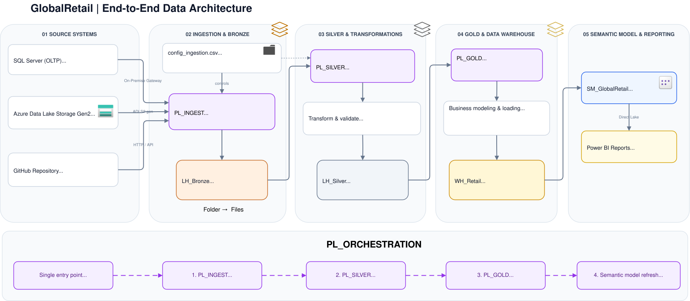

# Architecture Overview

## Introduction

This project implements an end-to-end **Medallion Architecture** using **Microsoft Fabric**, simulating a realistic retail data platform. It ingests data from three heterogeneous source systems, processes it through progressive layers of quality and structure and exposes a business-ready model for reporting via **Power BI** using **Direct Lake**.

The goal of this project is to demonstrate a production-style data engineering pattern: metadata-driven ingestion, layered transformation, incremental loading and semantic modeling, all built natively on Fabric (Lakehouses, Data Warehouse, Pipelines, Notebooks, Dataflows Gen2).

---

## High-Level Architecture

---

## Source Systems

Three different source types were chosen to simulate realistic enterprise integration patterns:

| Source | Type | Data | Rationale |
|--------|------|------|-----------|
| **Azure Data Lake Storage Gen2** | Batch file exports (CSV) | CRM (`customers`, `legacy_customers`) and ERP (`products`, `suppliers`, `inventory`) | Simulates batch exports from CRM/ERP systems, landing in a Data Lake before ingestion |
| **SQL Server** | OLTP relational database | `Orders`, `OrderDetails`, `OrderCampaign`, `Reviews` | Simulates the operational, transactional database of an e-commerce application |
| **GitHub Repository** | HTTP connector (files) | `product_catalog.json`, `marketing_campaigns.csv`, `web_logs.json` | Simulates semi-structured data delivered via an external API / file distribution service (e.g. Product PIM, marketing platform, clickstream logs) |

> ADLS Gen2 acts as the **Landing Zone**: it decouples source systems from the analytics platform, preserves an original copy of the data, enables reuse by other systems, and makes the ingestion process independent from source applications.

---

## Medallion Layers

### Bronze Layer
Contains **raw data only**, ingested as-is from the three sources. Data is never modified at this stage; it exists purely for traceability and reprocessing capability,hosted in a Fabric **Lakehouse**.

### Silver Layer
Contains **cleaned, deduplicated, standardized data**, with parsed semi-structured fields (e.g. nested JSON attributes/arrays flattened into columns), data quality checks, and audit logging. Hosted in a Fabric **Lakehouse**.

### Gold Layer
Contains the **business model**: a star schema with dimension and fact tables, built with explicit primary/foreign keys, hosted in a Fabric **Data Warehouse** and exposed through a **Direct Lake semantic model** for reporting.

---

## Fabric Components Used

| Component | Purpose |
|---|---|
| **On-premises Data Gateway** | Bridges the local SQL Server (OLTP) instance with Fabric cloud pipelines |
| **Lakehouses** (`LH_Bronze`, `LH_Silver`) | Store raw and cleaned data as Delta tables |
| **Data Warehouse** (`WH_Retail`) | Hosts the Gold layer star schema (dimensions & facts) |
| **Data Pipelines** | Orchestrate ingestion (metadata-driven) and layer-to-layer movement |
| **PySpark Notebooks** | Handle complex transformations, semi-structured data flattening and data quality profiling |
| **Dataflow Gen2** | Handles data cleaning (low-code transformation, Power Query) |
| **Semantic Model (Direct Lake)** | Exposes the Gold Warehouse model to Power BI |

---

## Design Principles

- **Metadata-driven ingestion**: a single configuration file (`config_ingestion.csv`) drives what gets ingested, from where, in which format and how, instead of hardcoding logic per source.
- **Separation of concerns per layer**: Bronze never transforms data; Silver never implements business logic; Gold never touches raw formats.
- **Multiple transformation engines by use case**:
  - PySpark Notebooks for large volumes, complex/nested data structures and audit logging
  - Dataflow Gen2 for smaller, low-code transformations (CRM cleansing)
  - T-SQL Stored Procedures for warehouse loading
- **Full load vs incremental load**: dimension tables are small and reloaded in full (`TRUNCATE` + `INSERT`); fact tables use a **watermark pattern** to load only new records, avoiding unnecessary reprocessing of large transactional tables.
- **Naming conventions** are enforced across all Fabric artifacts  to keep the workspace consistent and self-explanatory.

---

## Orchestration

A single **Orchestration Pipeline** (`PL_ORCHESTRATION`) triggers the entire flow end-to-end, in sequence:

1. `PL_INGEST` → ingest raw data into Bronze
2. `PL_SILVER` → clean and move data into Silver
3. `PL_GOLD` → load into Gold layer dimension and fact tables
4. **Semantic Model refresh** → updates `SM_GlobalRetail` so Power BI reports reflect the latest data
