# Gold Layer

> The Gold layer is the business-ready data warehouse layer, where trusted Silver data is transformed into a dimensional model optimized for analytics and reporting. Business logic, KPIs and relationships are consolidated into fact and dimension tables, providing a consistent and governed data foundation for the semantic model and Power BI reporting through Direct Lake.

---

# Table of Contents
## Table of Contents

1. [Fabric Objects & Structure](#fabric-objects--structure)

2. [Architecture](#architecture)

3. [Determining SQL Data Types](#determining-sql-data-types-nb_define_sql_gold_datatype)

4. [Data Warehouse Structure](#data-warehouse-structure)
   - [Schema Definition](#schema-definition)
   - [Silver-to-Gold Table Mapping](#silver-tables-relationship-and-related-gold-tables)
   - [Table Creation & PK/FK Constraints](#table-creation--pk--fk-constraints)
   - [Loading Strategies](#load-type-with-stored-procedure)
     - [Full Load - TRUNCATE + INSERT](#full-truncate--insert-into)
     - [Incremental Load - Watermark](#incremental-watermark)

5. [Resulting Gold Tables & Folder Structure](#resulting-gold-tables--folder-structure-in-wh_retail)

6. [Gold Pipeline](#pipeline-gold_pipeline)

7. [Semantic Model - Direct Lake](#semantic-model-direct-lake)
---

# Fabric Objects & Structure
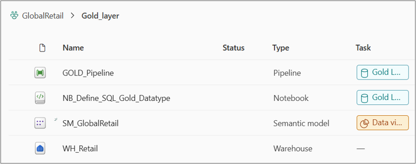

| Object | Type | Purpose |
|---|---|---|
| WH_Retail | Data Warehouse | Hosts the star schema (dimensions + facts) |
| NB_Define_SQL_Gold_Datatype | Notebook | Profiles Silver data to propose optimal SQL data types for Gold DDL |
| GOLD_Pipeline | Pipeline | Orchestrates all stored procedures (dimensions first, then facts) |
| SM_GlobalRetail | Semantic Model (Direct Lake) | Exposes WH_Retail directly to Power BI |

```text
GlobalRetail
│
└── Gold Layer
     │
     ├── WH_Retail
     │
     ├── NB_Define_SQL_Gold_Datatype
     │    
     ├── GOLD_Pipeline
     │
     └──SM_GlobalRetail
```

---

# Architecture
The Gold loading process follows this logical flow:

1. Read tables from the Silver Lakehouse.
2. Define the Warehouse schemas and table structures.
3. Apply primary key and foreign key metadata where supported.
4. Load dimension tables.
5. Wait for all required dimension loads to complete successfully.
6. Load fact tables using their configured incremental strategies.
7. Expose the resulting semantic model through `SM_GlobalRetail`.

The Warehouse stores the Gold data. 

`GOLD_Pipeline` coordinates the execution of the loading activities; it is not itself a data storage layer.

---

# Determining SQL Data Types: NB_Define_SQL_Gold_Datatype

Before creating the Gold DDL, a dedicated notebook analyzes every Silver table and proposes an appropriate SQL data type for each column, rather than guessing or defaulting everything to oversized generic types.

The full notebook is available here: [NB_Define_SQL_Gold_Datatype](../../fabric_workspace/03.%20gold_layer/NB_Define_SQL_Gold_Datatype.ipynb)

For every column of every Silver table, the notebook inspects the Spark data type and decides the most sensible SQL equivalent based on what is actually observed in the data:

- **Text columns** proposes a length based on the maximum observed value and a configured safety margin. Values that exceed the configured threshold may require a wider or unbounded text type.
- **Decimal/float columns** are analyzed to determine the actual precision and scale needed, based on the largest value present, which avoids the typical rounding issues that come from blindly using floating-point types for numbers that represent money or quantities.
- **Whole numbers, dates, timestamps, booleans and binary data** map in a fairly direct and predictable way to their SQL equivalents.
- **Unrecognized types** any column whose type cannot be confidently mapped falls back to a safe generic text type, but is explicitly flagged with a warning, so it gets a manual review rather than silently becoming a wrong assumption baked into the DDL.

The notebook also reports useful profiling information:

- Whether a column **contains `NULL`** values and how many were observed.
- Whether the table **contains duplicate** rows based on the comparison performed by the notebook.
- **Warnings for mappings** or data characteristics that require review.

The notebook output includes the original Spark type, proposed SQL type, null counts, duplicate indicators, and warnings. The report is also exported to the Silver Lakehouse for offline review.

 <div align="center">
  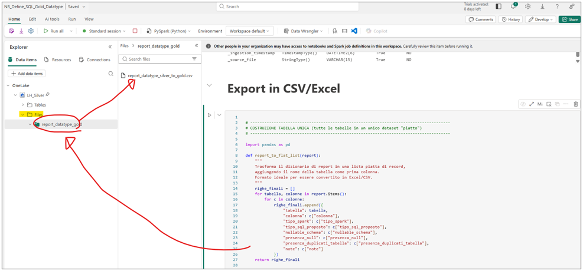
  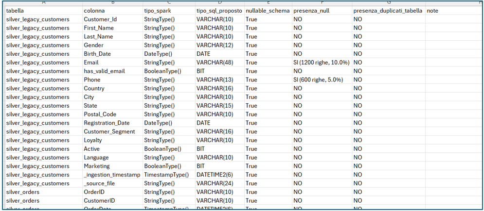
</div>

---

# Data Warehouse Structure

## Schema Definition
The DWH has organized grouping the tables into 4 schemas, each one representing a business domain instead of a source system:

| Schema | Tables | Purpose |
|---|---|---|
| _Shared_Dim | `dim_customers`, `dim_products`, `dim_date` | Shared analytical dimensions |
| _Transactions | `fact_orders`, `fact_orders_details` | Order transactions and order-line details |
| _Supply_Chain | `dim_suppliers`, `fact_inventory` | Supplier and inventory analytics |
| _Marketing | `dim_campaign`, `fact_order_campaign`, `fact_web_logs`, `fact_reviews` | Campaign, digital activity and review analytics |

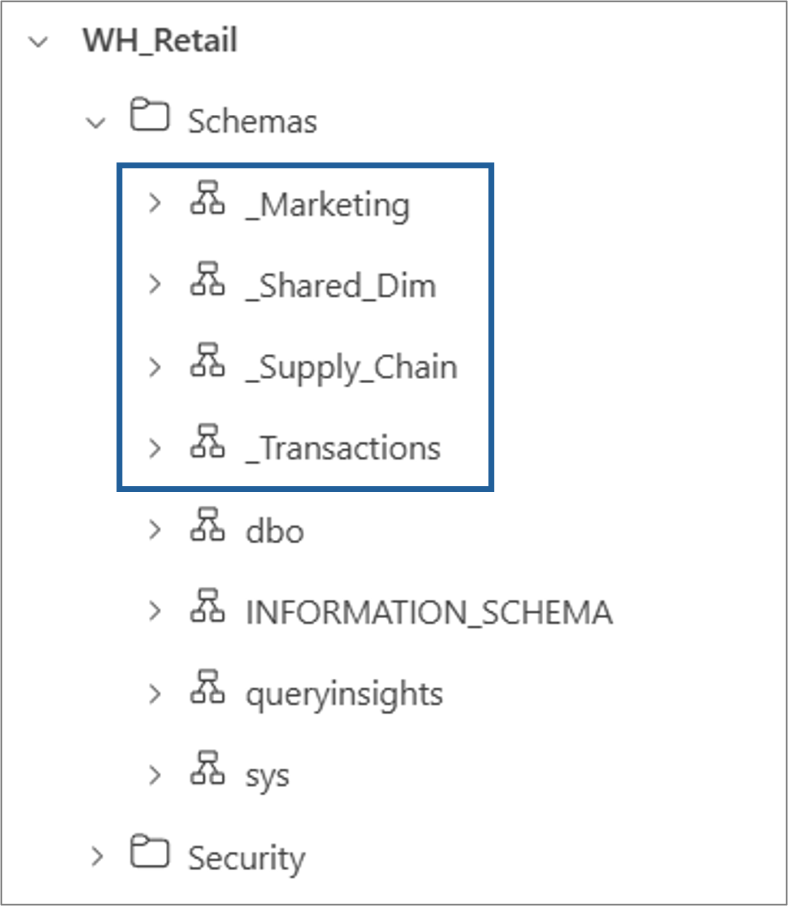

Here the SQL query to create the schemas: [01 Create Schemas.sql](../../fabric_workspace/03.%20gold_layer/01%20Create%20Schemas.sql)

---

## Silver tables relationship and related gold tables
For each Silver layer table, only the required columns were selected and relationships between tables were analyzed to support the design of the Gold layer. The resulting tables with selected columns and relative relationship is the following:
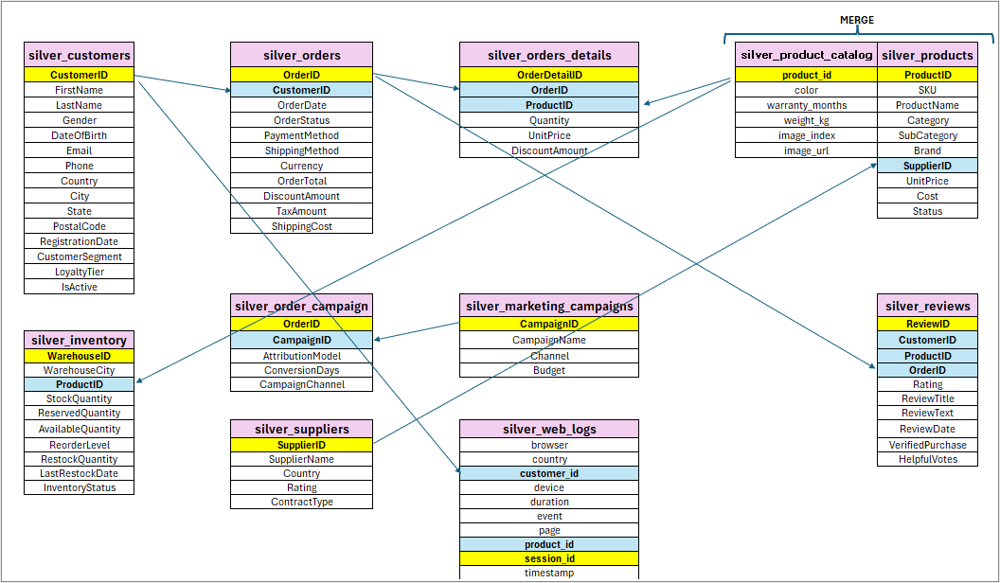

Each Silver table has a corresponding table in the Gold layer, containing only the columns required for analytics, except for silver_product_catalog and silver_products, which have been merged into a single dim_products table.
| Silver Tables              | Gold Tables         | Schema          |
|----------------------------|---------------------|-----------------|
| silver_customers           | dim_customers       | _Shared_Dim     |
| silver_product_catalog     | dim_products        | _Shared_Dim     |
| silver_products            | dim_products        | _Shared_Dim     |
| silver_orders              | fact_orders         | _Transactions   |
| silver_orders_details      | fact_orders_details | _Transactions   |
| silver_inventory           | fact_inventory      | _Supply_Chain   |
| silver_suppliers           | dim_suppliers       | _Supply_Chain   |
| silver_order_campaign      | fact_order_campaign | _Marketing      |
| silver_marketing_campaigns | dim_campaign        | _Marketing      |
| silver_web_logs            | fact_web_logs       | _Marketing      |
| silver_reviews             | fact_reviews        | _Marketing      |

---

## Table Creation & PK & FK constraints
Next, tables are created within their respective schemas, applying the SQL data types and constraints identified by the notebook and defined in the previous section.

The full SQL query to create the tables is available here: [02 Create Tables.sql](../../fabric_workspace/03.%20gold_layer/02%20Create%20Tables.sql)

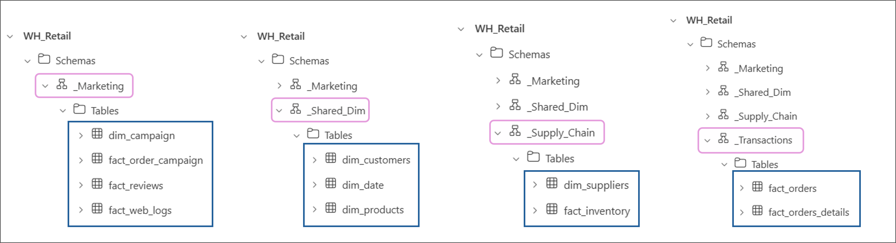
 
To ensure data integrity and consistency, primary key (PK) and foreign key (FK) constraints have also been defined on the tables, enforcing entity uniqueness and referential integrity across the data model.

The full SQL query to add PK and FK constraints is available here: 

[03 Add PK & FK constraints.sql](../../fabric_workspace/03.%20gold_layer/03%20Add%20PK%20&%20FK%20constraints.sql)

[03.1 Verify Primary Keys.sql](../../fabric_workspace/03.%20gold_layer/03.1%20Verifica%20Primary%20Keys.sql)

[03.2 Verify Foreign Keys.sql](../../fabric_workspace/03.%20gold_layer/03.2%20Verifica%20Foreign%20Keys.sql)

---

## Load type with Stored procedure
Gold tables use different loading strategies according to their purpose and expected behavior. The current design uses full reloads for dimensions and incremental processing for facts.

All table updates are implemented through SQL stored procedures:

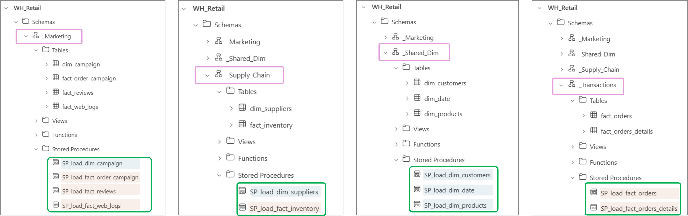

### Full (TRUNCATE + INSERT INTO)
Dimension tables (customers, products, suppliers, campaigns, date) are relatively small, slowly-changing reference data. Every time their stored procedure runs, the entire target table is cleared and reloaded from scratch, straight from Silver.

This is a deliberate simplicity choice: for tables of this size, a full reload is cheap and removes an entire category of bugs that incremental logic would introduce (partial updates, missed deletions, out-of-sync historical values). There is no meaningful cost trade-off here, the simplicity of "always start clean" outweighs any theoretical efficiency gain from a more complex incremental approach on data this size.

`dim_date` is a special case within this same "full overwrite" family: instead of being reloaded from a Silver table, it is entirely **generated** as a calendar sequence for a fixed date range, since a date dimension does not need a source system at all. It is pure derived data (day names, week numbers, month names, weekend flags, and similar attributes), so it makes more sense to generate it once for a wide range than to source it from anywhere.

The SQL stored procedures used for full load are available here: 

[04 STORED PROCEDURE dim_customers.sql](../../fabric_workspace/03.%20gold_layer/04%20STORED%20PROCEDURE%20dim_customers.sql)

[05 STORED PROCEDURE dim_products.sql](../../fabric_workspace/03.%20gold_layer/05%20STORED%20PROCEDURE%20dim_products.sql)

[06 STORED PROCEDURE dim_date.sql](../../fabric_workspace/03.%20gold_layer/06%20STORED%20PROCEDURE%20dim_date.sql)

[07 STORED PROCEDURE dim_suppliers.sql](../../fabric_workspace/03.%20gold_layer/07%20STORED%20PROCEDURE%20dim_suppliers.sql)

[08 STORED PROCEDURE dim_campaign.sql](../../fabric_workspace/03.%20gold_layer/08%20STORED%20PROCEDURE%20dim_campaign.sql)

For every stored procedure the output reports the execution status and row-count validation:
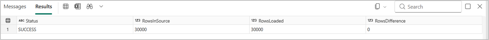

---

### Incremental (watermark)
Fact tables represent business events or observations that can grow over time. Reloading every fact table in full on each pipeline run can increase execution time and resource consumption as data volume grows.

The current implementation uses incremental loading procedures that identify records to be added to Gold. The exact control depends on the key and date logic implemented for each table.

The documented patterns include:

- **Key-based checks:** identify source records whose business or composite key is not yet present in Gold (es. order_id).
- **Date-based filtering:** restrict processing to a relevant time range, verifying last available date in the Gold table and loading from Silver only   data with dates > last gold table date.
- **Combined checks:** use a date filter to reduce the candidate set (without the necessity to scan the entire table) and a key-based check to avoid inserting records that already exist.

The appropriate pattern depends on the source data, target grain, available timestamps and key definition.

The SQL stored procedures used for incremental load are available here: 

[09 STORED PROCEDURE fact_orders_details.sql](../../fabric_workspace/03.%20gold_layer/10%20STORED%20PROCEDURE%20fact_orders.sql)

[10 STORED PROCEDURE fact_orders_details.sql](../../fabric_workspace/03.%20gold_layer/10%20STORED%20PROCEDURE%20fact_orders_details.sql)

[11 STORED PROCEDURE fact_inventory.sql](../../fabric_workspace/03.%20gold_layer/11%20STORED%20PROCEDURE%20fact_inventory.sql)

[12 STORED PROCEDURE fact_order_campaign.sql](../../fabric_workspace/03.%20gold_layer/12%20STORED%20PROCEDURE%20fact_order_campaign.sql)

[13 STORED PROCEDURE fact_web_logs.sql](../../fabric_workspace/03.%20gold_layer/13%20STORED%20PROCEDURE%20fact_web_logs.sql)

[14 STORED PROCEDURE fact_reviews.sql](../../fabric_workspace/03.%20gold_layer/14%20STORED%20PROCEDURE%20fact_reviews.sql)

---

# Resulting Gold Tables & Folder Structure in WH_Retail

```text
WH_Retail
|
├── Schemas
|     ├── _Marketing
|     |     ├── Tables
|     |     |     ├── dim_campaign
|     |     |     ├── fact_order_campaign
|     |     |     ├── fact_reviews
|     |     |     └── fact_web_logs
|     |     |
|     |     └── Stored Procedures
|     |           ├── SP_load_dim_campaign
|     |           ├── SP_load_fact_order_campaign
|     |           ├── SP_load_fact_reviews
|     |           └── SP_load_fact_web_logs
|     |
|     ├── _Shared_Dim
|     |     ├── Tables
|     |     |     ├── dim_customers
|     |     |     ├── dim_date
|     |     |     └── dim_products
|     |     |
|     |     └── Stored Procedures
|     |           ├── SP_load_dim_customers
|     |           ├── SP_load_dim_date
|     |           └── SP_load_dim_products
|     |
|     ├── _Supply_Chain
|     |     ├── Tables
|     |     |     ├── dim_suppliers
|     |     |     └── fact_inventory
|     |     |
|     |     └── Stored Procedures
|     |           ├── SP_load_dim_suppliers
|     |           └── SP_load_fact_inventory
|     |
|     └── _Transactions
|           ├── Tables
|           |     ├── fact_orders
|           |     └── fact_orders_details
|           |
|           └── Stored Procedures
|                 ├── SP_load_fact_orders
|                 └── SP_load_fact_orders_details
| 
└── Queries
     ├── 01_Create_Schemas.sql
     ├── 02_Create_Tables.sql
     ├── 03_Add_PK_FK_Constraints.sql
     ├── 04_Verify_Primary_Keys.sql
     ├── 05_Verify_Foreign_Keys.sql
     ├── 06_SP_dim_customers.sql
     ├── 07_SP_dim_products.sql
     ├── 08_SP_dim_date.sql
     ├── 09_SP_dim_suppliers.sql
     ├── 10_SP_dim_campaign.sql
     ├── 11_SP_fact_orders.sql
     ├── 12_SP_fact_orders_details.sql
     ├── 13_SP_fact_inventory.sql
     ├── 14_SP_fact_order_campaign.sql
     ├── 15_SP_fact_web_logs.sql
     └── 16_SP_fact_reviews.sql
```

---

# Pipeline: GOLD_Pipeline
All the stored procedures described above are not run manually or independently, they are orchestrated by a single pipeline, `GOLD_Pipeline`, which enforces the correct execution order.

Dimension tables use an overwrite loading strategy, while fact tables are loaded incrementally. Therefore, all dimension-loading procedures must complete successfully before fact-table processing begins. This sequencing ensures that foreign key (FK) references remain valid and that fact-loading logic can rely on up-to-date dimensional data for joins and lookups.

The pipeline is organized into sequential execution phases, with parallel processing enabled within each phase wherever dependencies allow:
- **Phase 1 Dimensions:** Load all dimension tables running the realted stored procedures and using the overwrite strategy. Stored procedures can run in parallel because there are no dependencies between them.
- **Wait instruction:** acting as an explicit synchronization point; nothing in Phase 2 starts until every dimension load in Phase 1 has completed successfully.
- **Phase 2 Fact Tables:** Once all dimensions are confirmed loaded, every fact-loading stored procedure runs, again in parallel with each other. Facts do not depend on one another either so the same parallelization logic applies here for the same reason

  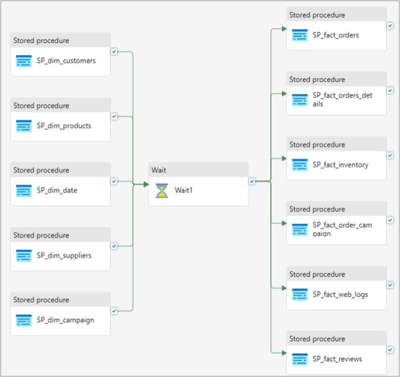

This approach balances data consistency and referential integrity with execution efficiency through controlled parallelism.

---

# Semantic Model: Direct Lake
Once the Warehouse is fully populated, a **semantic model** is built directly on top of it using **Direct Lake** mode, and exposed to Power BI as `SM_GlobalRetail`.

All dimension and fact tables from the Warehouse are added to the semantic model and the same relationships already enforced at the database level via foreign keys are recreated as model relationships.

This mirrors the star schema designed at the Warehouse level, so the semantic model is not introducing a new data model, it is just exposing the existing Gold model in a form Power BI can consume interactively.

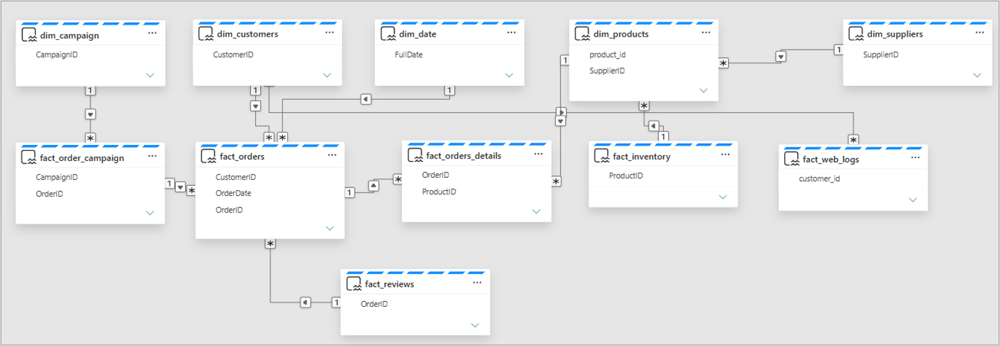

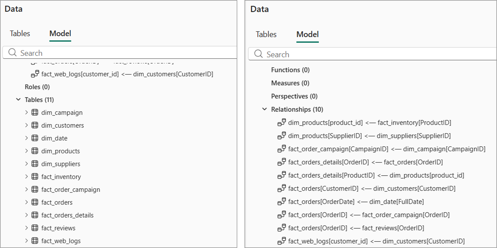
