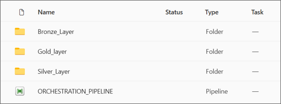
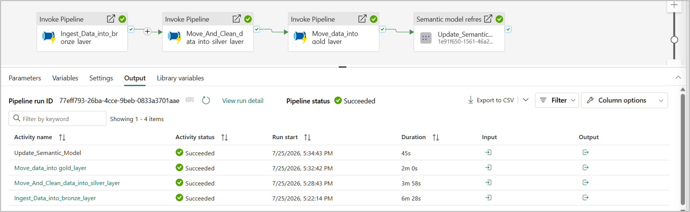

# ORCHESTRATION_PIPELINE

A single top-level pipeline ties every layer together into one repeatable, end-to-end execution: `ORCHESTRATION_PIPELINE` triggers, in strict sequence, the ingestion pipeline into Bronze, the transformation pipeline into Silver, the loading pipeline into Gold, and finally a refresh of the semantic model.

    Invoke Pipeline: PL_INGEST           (Bronze ingestion)
        |
        v
    Invoke Pipeline: Silver_Pipeline     (Bronze -> Silver transformation)
        |
        v
    Invoke Pipeline: GOLD_Pipeline       (Silver -> Gold loading)
        |
        v
    Semantic Model Refresh: SM_GlobalRetail

Each stage only starts once the previous one has fully succeeded, since every layer depends on the one before it being complete and correct.

This single pipeline is effectively the "run everything" button for the whole platform: triggering it end-to-end takes raw source data all the way through to a refreshed, reportable semantic model, with no manual intervention required at any intermediate step.

